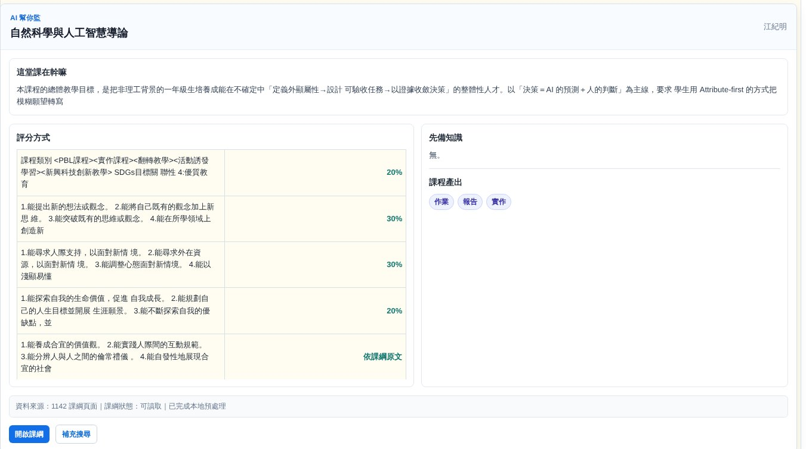
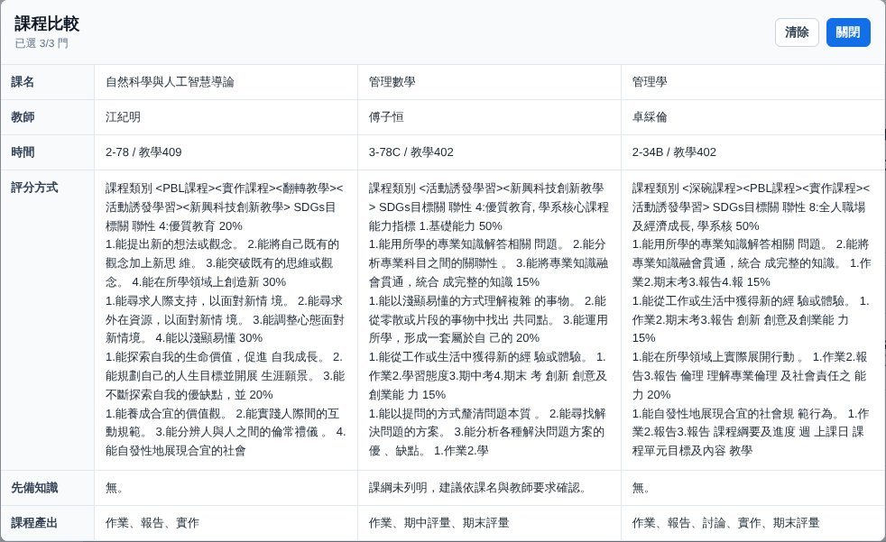
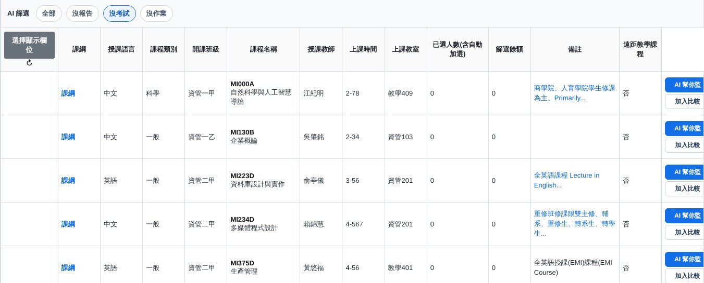
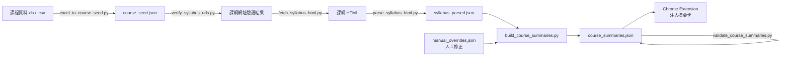

# 🎓 AI 幫你監 — 中原選課課綱摘要 Chrome Extension

在中原大學選課的課程列表旁加上「AI 幫你監」按鈕，一鍵展開這門課的**課綱摘要卡**：課程在教什麼、怎麼評分、需要什麼先備知識、會有哪些作業或報告，不用再一門一門點進課綱慢慢找。

> 本作品是原型：不是選課系統，也不代選課。目前只在本機的 FAKE HTML Demo 課程列表上運作，讀取的是預先整理好的本地摘要 JSON。

---

## 😩 解決的問題

學生選課時，常要逐一點開課綱才看得到課程內容、評分方式、先備知識與可能的產出。本工具把公開課綱中**已經存在**的資訊整理到課程列表同一頁，減少來回點擊與遺漏。

---

## ✨ 功能

| 功能 | 說明 |
|---|---|
| 📋 課綱摘要卡 | 白話摘要、評分方式、先備知識、課程產出（報告、考試、作業等） |
| ⚖️ 課程比較 | 把課程加入比較，最多同時比較 3 門 |
| 🔎 快速篩選 | 一鍵篩出「沒報告」「沒考試」「沒作業」的課 |
| 🌐 補充搜尋 | 產生 Google 搜尋連結，讓學生自己查評價（不爬任何評論網站） |
| ✍️ 人工修正 | 自動解析不到的課，可在 `manual_overrides.json` 手動補上 |

本版本使用**規則式解析**，不呼叫 Gemini、OpenAI 或任何 LLM API。

---

## 📸 系統畫面

> 以下截圖來自本機 FAKE Demo 頁與載入的 Extension；頁面上的學號已遮蔽。

**課綱摘要卡**：點課程列旁的「AI 幫你監」展開



| 課程比較（最多 3 門） | 快速篩選「沒考試」的課 |
|---|---|
|  |  |

---

## 🏗️ 資料處理流程



所有資料都在本機處理好，瀏覽器端只讀取 Extension 內附的 JSON。更多說明見 [docs/ARCHITECTURE.md](docs/ARCHITECTURE.md)。

---

## 🚀 快速展示

給展示人員的逐步操作說明：[docs/USER_GUIDE.md](docs/USER_GUIDE.md)。

### 1. 安裝 Chrome Extension

1. 開啟 Chrome `chrome://extensions/`
2. 開啟右上角「開發人員模式」
3. 點「載入未封裝項目」
4. 選擇本專案的 `extension/` 資料夾

### 2. 啟動 Demo 頁

```bash
python -m http.server 8765    # 或 npm run serve
```

打開 http://localhost:8765/demo/fake_selection_system.html 。頁面本身會載入完整課程表格，摘要、比較與篩選則由 Extension 注入。

### 3. 操作

1. 點課程列旁的「AI 幫你監」
2. 展開摘要卡，查看摘要、評分方式、先備知識、課程產出與補充搜尋
3. 試試上方的篩選按鈕，或把幾門課加入比較

Extension 無法載入時，可以直接開 `demo/integrated_backup.html`，它會顯示同一批摘要資料。

---

## 🔧 更新課程資料

### 1. 放入課程資料

把 `課程資料.xls` 放到 `tools/raw/excel/`。如果 Python 沒有舊版 `.xls` 的讀取引擎，可以用 Excel 另存成 CSV（或安裝 `xlrd`）。

### 2. 依序執行處理工具

`excel_to_course_seed.py` 會保留 `courseCode` 作為頁面比對代碼，並用 Excel 的「課程代碼」產生 `opCode` 與課綱網址。

```bash
python tools/excel_to_course_seed.py --input tools/raw/excel/課程資料.csv --year-term 1142 --output extension/data/course_seed.json
python tools/verify_syllabus_urls.py --input extension/data/course_seed.json --output tools/output/syllabus_url_check.json
python tools/fetch_syllabus_html.py --input extension/data/course_seed.json --check tools/output/syllabus_url_check.json --output-dir tools/raw/syllabus_html
python tools/parse_syllabus_html.py --input-dir tools/raw/syllabus_html --output tools/output/syllabus_parsed.json
python tools/build_course_summaries.py --seed extension/data/course_seed.json --parsed tools/output/syllabus_parsed.json --overrides tools/manual_overrides.json --output extension/data/course_summaries.json
python tools/validate_course_summaries.py extension/data/course_summaries.json
```

### 3. 人工修正

編輯 `tools/manual_overrides.json`，再重跑 `build_course_summaries.py` 與 `validate_course_summaries.py`：

```json
{
  "MI123H": {
    "plainSummary": "本課介紹資訊管理概念、企業流程與資訊系統應用。",
    "prerequisites": "課綱未明確要求。",
    "courseOutputs": ["期中報告", "期末報告"]
  }
}
```

---

## 🧪 測試

```bash
npm test               # python -m unittest discover -s tests
npm run validate       # 驗證 course_summaries.json 格式
npm run verify-demo    # 驗證 Demo 頁與 Extension 的對應關係
```

---

## 📁 專案結構

```text
.
├─ extension/        # Chrome Extension（MV3）
│  ├─ manifest.json
│  ├─ content.js     # 掃描課程列、注入摘要卡、比較與篩選
│  ├─ popup.html/js  # 顯示狀態與重新掃描
│  └─ data/          # 課程種子與摘要 JSON
├─ demo/             # 本機 FAKE 選課頁與備援頁
├─ tools/            # 資料轉檔、網址驗證、抓取、解析、合併工具
├─ tests/            # 單元測試
└─ docs/             # PRD、架構、資料格式、隱私、限制、展示腳本
```

---

## 🔒 隱私與限制

- 不要求帳密、不登入校方系統、不讀取個人課表、成績或點名資料
- 不爬 Dcard、PTT、歐趴糖評論，只產生 Google 搜尋連結
- 有些公開課綱頁雖然回應正常，但內容不含可解析的課綱，請以 `tools/output/syllabus_url_check.json` 為準

詳見 [docs/PRIVACY.md](docs/PRIVACY.md)、[docs/LIMITATIONS.md](docs/LIMITATIONS.md)。

---

## 🔒 擴充功能的資安防護

- Manifest 採用**最小權限**，移除未使用的儲存權限與廣泛主機權限。內容腳本只在 `localhost`、`127.0.0.1` 的展示頁載入。擴充功能封裝的摘要資料也只開放給本機 HTTP 來源。
- **課綱連結**須符合中原官方課綱站的 HTTPS 來源。資料缺漏或網址不符時，使用依課號產生的官方預覽連結。評分比例轉成 HTML 前也會跳脫。

7 項測試及 58 筆課程摘要比對通過。已在隔離的 Chromium 載入擴充功能，確認 58 筆摘要卡、課綱連結、課程比較，以及其他本機頁面不注入。展示請透過本機 HTTP 網址開啟。見 [Manifest V3 設定](extension/manifest.json)、[摘要呈現與連結檢查](extension/content.js)。

## ❓ 常見錯誤

| 狀況 | 解法 |
|---|---|
| `無法讀取 .xls` | 用 Excel 另存 CSV，或安裝 `xlrd` |
| 按鈕沒出現 | 確認 Extension 已載入，且網址是 `http://localhost:8765/demo/fake_selection_system.html` |
| 摘要顯示「尚未解析」 | 課綱 URL 未開放或 HTML 不含關鍵字，可用 `manual_overrides.json` 補正 |

---

## 📚 文件

- 專題文件：[作品構想書](AI幫你監作品構想書.pdf)、[簡報](中原AI幫你監簡報.pdf)、未來成果報告書（`AI幫你監未來成果報告書V2.docx`）
- 產品與技術：[PRD](docs/PRD.md)、[架構](docs/ARCHITECTURE.md)、[資料格式](docs/DATA_SCHEMA.md)、[驗證計畫](docs/VERIFICATION_PLAN.md)
- 展示：[使用教學](docs/USER_GUIDE.md)、[展示腳本](docs/DEMO_SCRIPT.md)
